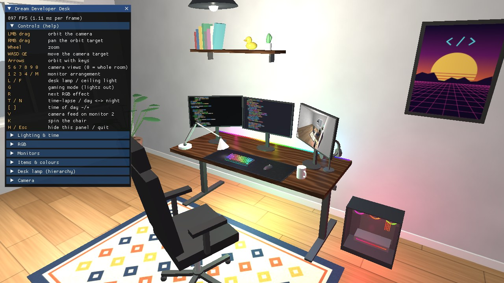
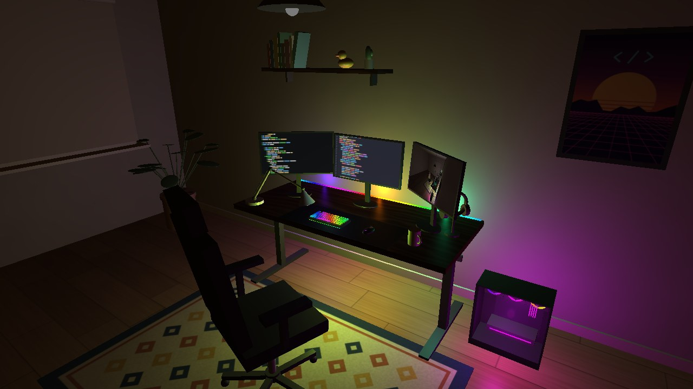
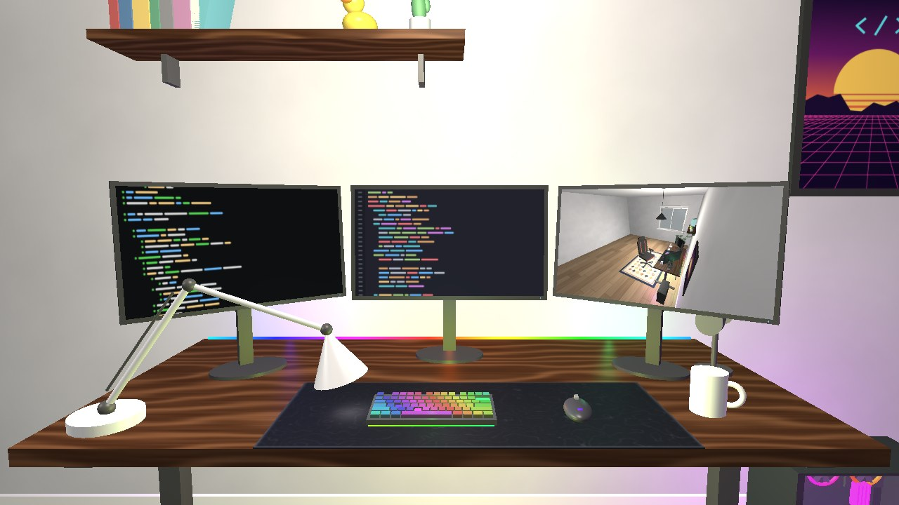
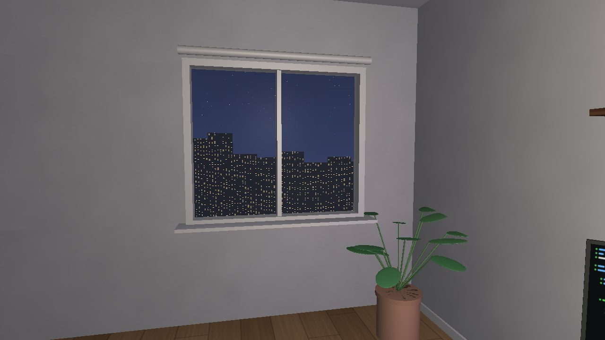
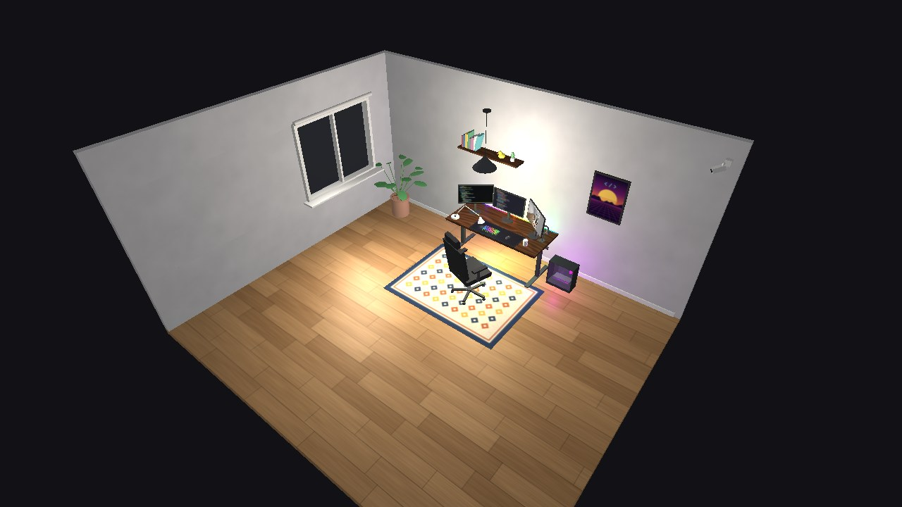

# Dream Developer Desk

**Computer Graphics Fundamentals - Final Project, topic 28 (★)**

A real-time 3D programmer's room in modern OpenGL 3.3 core: a desk with up to three
monitors, an RGB mechanical keyboard, an articulated desk lamp, a gaming PC with
spinning fans, a chair, a plant and a window with a day/night sky. A security camera
in the corner films the room, and its picture appears live on one of the monitors.
Press **G** at night and the room goes dark while the RGB lights take over.



| Gaming mode (wow moment) | Security camera on monitor 2 |
|---|---|
|  |  |
| **Night sky and city through the window** | **Whole room (walls cut away)** |
|  |  |

> Screenshots taken on the development laptop (NVIDIA RTX 4060 Laptop GPU), 1280x720.

---

## Build and run

The project is built the same way as our course assignments: **C++, OpenGL 3.3 core,
GLFW + GLAD, one `Makefile`, built with `make`**. GLFW for Windows (header and static
libraries for MSVC and MinGW) is the same package as in our Assignment 1. The other
libraries (stb_image, Dear ImGui) are header-only or compiled from source by the
Makefile, so everything is in `external/` and nothing else has to be installed.
Vectors and matrices are written by hand in `src/core/Math.h`, like `common.h` of our
assignments; no math library is used.

### Recommended OS for testing

**Windows 10/11.** Tested on Windows 11 Pro with GNU Make 4.4.1 + Visual Studio 2022 (MSVC),
run from the "x64 Native Tools Command Prompt".

The Makefile also supports MinGW-w64, Linux and macOS (see below).

### Requirements

* **Windows:** GNU make and a C++17 compiler - either Visual Studio 2019/2022 (then run
  `make` from the "x64 Native Tools Command Prompt") or MinGW-w64 g++ 9 or newer
  (for example MSYS2: `pacman -S make mingw-w64-ucrt-x86_64-gcc`, then use the UCRT64 shell).
  The Makefile selects MSVC automatically when `cl.exe` is in `PATH`, otherwise MinGW g++
  (can be forced with `make TOOLCHAIN=mingw` or `make TOOLCHAIN=msvc`).
* **Linux (Debian/Ubuntu):** `sudo apt install build-essential pkg-config libglfw3-dev`
  (Fedora: `sudo dnf install gcc-c++ make pkgconf glfw-devel`).
* **macOS:** Xcode Command Line Tools (`xcode-select --install`) and
  `brew install glfw pkg-config`.
* A graphics driver that supports OpenGL 3.3.

### Build

```
git clone https://github.com/MarioAman07/Dream-Developer-Desk.git
cd Dream-Developer-Desk
make
```

The default target compiles all sources into `obj/` and links the program
`DreamDesk.exe` (`DreamDesk` on Linux / macOS) into this folder; `make -j8` builds in
parallel. `make clean` removes the program and the object files.

### Run

From inside the project folder:

| OS            | Command |
|---------------|---------|
| Windows       | `DreamDesk.exe` (in MSYS2 / Git Bash: `./DreamDesk.exe`) |
| Linux / macOS | `./DreamDesk` |

The shaders and textures are loaded at run time from `shaders/` and `assets/`. They are
looked up relative to the current directory and, if not found there, relative to the
folder of the executable, so the program also works when started from another directory.
If something goes wrong (missing file, shader compile error, no OpenGL 3.3 support) the
program prints an error message to the console. At start it also prints the controls
there.

The textures in `assets/textures/` are generated by `tools/generate_textures.py`.
They are already in the repository; run `python tools/generate_textures.py`
(needs `numpy` and `pillow`) only if you want to regenerate them.

---

## Controls

An **on-screen help panel** (Dear ImGui) lists every control; `H` hides it.
The camera is an orbit camera around the desk.

| Input | Action |
|---|---|
| Left mouse drag | Orbit around the desk |
| Right mouse drag | Pan the orbit target |
| Mouse wheel | Zoom |
| `W A S D`, `Q E` | Move the orbit target (hold `Shift` = faster) |
| Arrow keys | Orbit with the keyboard |
| `5` `6` `7` `8` `9` | Camera views: overview, keyboard, monitors, PC, window |
| `0` | Whole room from outside (walls are cut away) |
| `1` `2` `3` `4` / `M` | Monitor arrangement: single, dual, triple, main + portrait / next |
| `L` | Desk lamp on/off |
| `F` | Ceiling light on/off |
| `G` | **Gaming mode**: blinds roll down, lights fade out, RGB gets brighter |
| `R` (`Shift+R`) | Next (previous) RGB effect: rainbow wave, spectrum, breathing, static, off |
| `T` | Time-lapse on/off |
| `N` | Jump between day and night |
| `[` `]` | Time of day - / + |
| `V` | Security camera feed on monitor 2 on/off |
| `K` | Spin the chair |
| `H` | Hide / show the ImGui panel |
| `Esc` | Quit |

The ImGui panel also has: time-of-day slider, light switches, RGB effect/speed/colour,
monitor arrangement and content of each screen, **items to show/hide**, **colours**
(desk, walls, chair), the desk lamp joint angles, the camera views and the FPS.

---

## Requirements R1-R8

| # | Requirement | How this project meets it | Where in the code |
|---|---|---|---|
| R1 | Modern pipeline | OpenGL 3.3 core profile; every mesh has its own VAO/VBO/EBO; own GLSL shaders in separate `.vert`/`.frag` files; no fixed-function calls | `gfx/Mesh.*`, `gfx/Shader.*`, `shaders/` |
| R2 | Scene setup | ~200 mesh nodes: room, window, desk, 3 monitors, keyboard (74 keys), mouse, mug, headphones, lamp, chair, plant, PC, shelf with books, rubber duck, cactus, poster, rug, ceiling lamp, security camera | `scene/Scene*.cpp` |
| R3 | Transformations | Model matrix `world = parent * T * R * S` per node, view from `lookAt`, perspective projection - all matrices written by hand in `core/Math.h` (translation, rotation X/Y/Z, scaling, `lookAt`, `perspective`, normal matrix). Hierarchies: lamp base -> arm -> arm -> head -> bulb; monitor stand -> pole -> hinge -> panel -> screen; PC fan -> rotor -> blades; chair base -> swivel -> backrest; security camera mount -> pan -> tilt | `core/Math.h`, `scene/SceneNode.*`, `scene/Camera.*` |
| R4 | Lighting | **Phong lighting model** of the lecture "Shading" with the halfway vector (as in our Assignment 3), computed per fragment: ambient + diffuse + specular, distance attenuation `1 / (a + b d + c d^2)`, spot lights with a cutoff angle and `cos^e` falloff; up to 8 point lights and 2 spot lights. Colours that are too bright are clamped to 1. The desk top casts a shadow for the desk lamp, the ceiling light and the window light (line segment from the point to the light intersected with the desk rectangle, lecture "Geometry"), so the lamp does not shine through the desk. The desk lamp spot follows the lamp head (moves) and toggles with `L`; the window sun/moon spot moves with the time of day; the ceiling light toggles with `F`; RGB lights change colour | `shaders/scene.frag`, `scene/DeskScene.cpp` (`collectLights`) |
| R5 | Texturing | Wood desk, wooden floor, walls, rug, desk mat, poster and monitor screens use textures with correct UVs, **mipmaps** (`glGenerateMipmap`, `GL_LINEAR_MIPMAP_LINEAR`). Boxes get UVs in metres, so textures are not stretched. Screen UVs scroll (code), the sky is procedural | `gfx/Texture.*`, `gfx/Primitives.cpp` |
| R6 | Interaction | Orbit camera (mouse + keyboard, smooth and frame-rate independent, 6 preset views). Scene interactions: monitor arrangements, lamp/ceiling light, gaming mode, RGB effects, time of day, camera feed, chair spin, lamp joints, items and colours in the UI | `core/App.cpp`, `ui/Gui.cpp` |
| R7 | Performance | FPS and frame time in the window title **and** in the ImGui panel | `core/FpsCounter.h`, `core/App.cpp`, `ui/Gui.cpp` |
| R8 | Build | Same as our assignments: GNU Make + `Makefile` (MSVC or MinGW on Windows, g++/clang++ on Linux/macOS), GLFW + GLAD in `external/`, other libraries built by the Makefile; build steps above | `Makefile` |

### Stretch goals (from topic 28)

1. **Monitor showing the scene from another camera (render-to-texture).** A security
   camera on the wall pans left and right. Every frame the scene is rendered from it
   into a 640x360 frame buffer object (colour texture + depth renderbuffer, lecture
   "Pixels and Buffers"), and the texture is shown on monitor 2 with washed-out
   CCTV colours. While this picture is drawn, the monitor that shows it is dark,
   because a texture cannot be read and written in the same pass.
2. **Day/night window light.** The time of day (slider, `[` `]`, `N`, time-lapse `T`)
   moves the sun and changes its colour and strength; at night it becomes cold
   moonlight. The window shows a procedural sky: gradient, sun disc, stars and a
   city skyline whose windows light up at night.
3. **ImGui panel to choose items and colours.** Show or hide nine groups of objects,
   change desk tint, wall, chair and accent colours, RGB colour, lamp colour and more.

### Extra features

- **Gaming mode (wow moment).** The roller blind comes down, the room lights fade out,
  RGB brightness and fan speed go up, and the screens get a little brighter. All of
  these fade smoothly.
- **Keyboard in one draw call.** All 74 keycaps are merged into one static mesh at
  startup (batching). Each vertex stores the phase of the RGB wave and the number of
  its key; the shaders compute the RGB colour and the "ghost typing" (random keys
  dip down) from them.
- **Animated monitor arrangements.** Monitors slide, turn, shrink away or rotate into
  portrait mode.
- **Cut-away walls.** Walls between the camera and the room are hidden, so the orbit
  camera can look in from outside.
- Transparent glass (window, PC side panel): blending, drawn back to front after the
  opaque objects with a read-only depth buffer (lecture "Pixels and Buffers"); plant
  leaves sway like a wave in the vertex shader (lecture "Procedural Methods");
  4x multisample anti-aliasing (as in our Assignment 4).

---

## Performance

The FPS and the frame time are shown in the window title and in the ImGui panel.
VSync is on, so normally the FPS equals the refresh rate of the monitor (60 Hz or more);
the frame time shows how long one frame really takes.

| Machine | GPU | Resolution | FPS | Frame time |
|---|---|---|---|---|
| Laptop, Windows 11 Pro | NVIDIA GeForce RTX 4060 Laptop GPU | 1280x720 | 897 (window in the background, not limited by VSync) | 1.11 ms |
| _TODO: TA machine / lab PC_ | _TODO_ | 1280x720 | _TODO_ | _TODO_ |

The scene is static geometry uploaded once at startup. Per frame only uniforms
change; all keycaps are one mesh (one draw call), and the camera feed is rendered
only when a monitor shows it.

---

## Project structure

```
Makefile                  build script (make / make clean), same structure as in our assignments
shaders/
  scene.vert / scene.frag Phong lighting, emissive screens, RGB effects, keycaps, plant sway
  sky.vert / sky.frag     procedural sky outside the window
src/
  main.cpp                starts App
  core/                   App (window, loop, input), Math (vectors, matrices), Paths, FpsCounter
  gfx/                    Shader, Mesh, Primitives, Texture, Framebuffer
  scene/                  SceneNode, Camera, Material, Lights, Environment (day/night),
                          Keyboard, MonitorRig, DeskScene + SceneRoom/SceneDesk/SceneProps
  render/                 Renderer (opaque -> sky -> transparent)
  ui/                     Gui (Dear ImGui panel)
  util/                   Rgb (CPU copy of the shader RGB effect)
assets/textures/          generated textures (see tools/)
tools/generate_textures.py procedural texture generator
external/
  glad/glad.c             GLAD OpenGL 3.3 core loader
  include/                GLAD and KHR headers
  glfw/                   GLFW 3.5.1 header and Windows libraries (MSVC and MinGW), as in Assignment 1
  stb/ imgui/             stb_image 2.31, Dear ImGui 1.91.9b (compiled by the Makefile)
docs/screenshots/         images for this README
```

---

## Team

| Member (surname, name, group) | Area | Main files |
|---|---|---|
| Chepurnenko Sergey, SE-2422 | Engine core and build: window and main loop, vector/matrix math (`lookAt`, `perspective`, normal matrix), shader, texture (mipmaps) and framebuffer classes, MSAA, texture generator, Makefile, README and CREDITS | `core/Math.h`, `core/App.*` (window, loop), `core/Paths.*`, `core/FpsCounter.h`, `gfx/Shader.*`, `gfx/Texture.*`, `gfx/Framebuffer.*`, `tools/`, `Makefile` |
| Baku Aman, SE-2422 | Scene and hierarchy: mesh class and primitives, scene graph (`T * R * S`, parent -> child), room, desk, lamp joints, chair, plant, PC, keyboard as one batched mesh, monitor arrangements, cut-away walls | `gfx/Mesh.*`, `gfx/Primitives.*`, `scene/SceneNode.*`, `scene/DeskScene.*`, `scene/Scene*.cpp`, `scene/Keyboard.*`, `scene/MonitorRig.*` |
| Mussilimov Zhangir, SE-2422 | Lighting and shaders: Phong model, point and spot lights, attenuation, RGB effects (HSV), day/night and the sky, gaming mode, desk shadow | `shaders/`, `scene/Lights.h`, `scene/Material.h`, `scene/Environment.*`, `util/Rgb.h` |
| Zhumash Adilzhan, SE-2422 | Interaction, rendering and UI: orbit camera and input, renderer (draw order, transparent glass sorted back to front), security camera render-to-texture, ImGui panel and settings | `scene/Camera.*`, `core/App.cpp` (input), `render/`, `ui/`, `scene/Settings.h` |

---

## AI Use

- **Tool:** Claude (Anthropic).
- **Used for:** writing the program code (C++, GLSL shaders, Makefile and the
  texture generator script), explaining parts of the code, finding the causes of bugs,
  and editing the text of the report and this README.
- **How we worked:** the main code was written by the AI from our description of the
  room (objects, hierarchies, lights and effects). Our work was to review, edit and fix
  it: each member read the code of their part, ran and tested the program, fixed the
  bugs, tuned positions, colours and light values by hand, and rewrote the parts that
  used techniques outside our course (GLM, instancing, tone mapping) with the methods
  from the lectures and Assignments, so that every member can explain all of their
  code.

**What each member changed in the AI-written code:**

- **Chepurnenko Sergey** - replaced GLM with our own `core/Math.h`, written like
  `common.h` of the assignments (matrices are stored column by column, so they are sent
  to the shaders without transposing; normal matrix for non-uniform scaling). Rewrote
  the `Makefile` in the style of our assignments: MSVC or MinGW is chosen automatically,
  and MinGW links statically, so no DLLs are needed. Added clear error messages for
  shaders and textures (a missing texture is drawn in magenta), made the program find
  `shaders/` next to the executable, and limited `dt` to 0.1 s, so the animations do not
  jump after the window is dragged.
- **Baku Aman** - fixed z-fighting (flickering stripes): the plant soil, PC glass,
  poster and monitor screens are now a few millimetres in front of the surface behind
  them. Split the node transform into a part that the children inherit and a mesh-only
  scale, because scaling a lamp arm also stretched the lamp head. Changed the keyboard
  from instancing to one batched mesh (74 keys, one draw call), made box UVs in metres,
  so the desk wood is not stretched, and tuned the positions of the four monitor
  arrangements.
- **Mussilimov Zhangir** - rewrote `shaders/scene.frag` with the formulas of the lecture
  "Shading" (attenuation, spot cutoff with `cos^e`, `min(I, 1)`); tone mapping and gamma
  were removed and the light colours were tuned again using screenshots. Added the desk
  shadow (the line segment to the light intersected with the desk plane), so the desk
  lamp no longer shines through the desk. Made the specular highlight appear only on
  the lit side, wrote the CPU copy of the RGB effect (`util/Rgb.h`), so the glow on the
  wall matches the LEDs, and placed the stars randomly in the sky, so they do not form
  a grid.
- **Zhumash Adilzhan** - fixed the camera buttons in the ImGui panel: "Monitors" and
  "PC" had the same ImGui ID as a header and a checkbox, solved with `PushID`. Made the
  orbit camera move smoothly with `ease()`, the camera views turn the short way round,
  and the target stays inside the room; clicks and keys used by the panel no longer move
  the camera. In the renderer, glass is sorted back to front and drawn after the opaque
  objects, and the security camera picture is rendered only when a monitor shows it.

Every team member has read the code in their area and can explain it.

## Credits

All third-party code and references are listed in [CREDITS.md](CREDITS.md).
No third-party models or textures are used: all geometry is built in code and all
textures are generated by `tools/generate_textures.py`.
